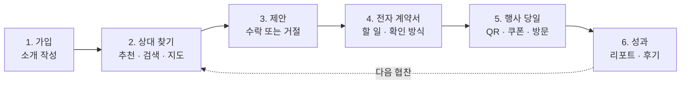
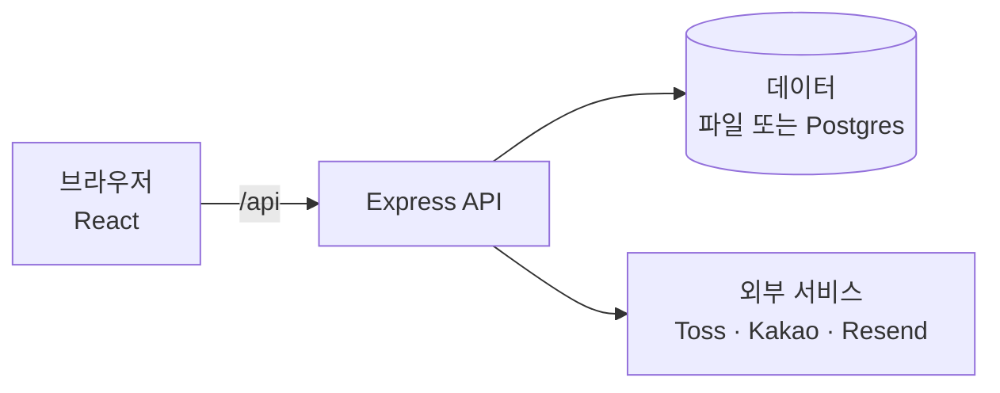

# uniconnect

**학생단체와 브랜드를 이어 주는 대학 협찬 매칭 서비스다.** 협찬 상대를 찾는 일부터 계약, 행사 현장 확인, 성과 리포트까지 한곳에서 처리한다.

- 사이트: https://uniconnect-pied.vercel.app
- 상태: 프로토타입이다. 약관과 개인정보 처리방침은 초안이고, 결제는 시연용 테스트 키로 동작한다.

## 한눈에 보기

| 질문 | 답 |
| --- | --- |
| 누가 쓰나 | 협찬이 필요한 학생단체와, 대학생에게 다가가려는 브랜드 |
| 무엇을 푸나 | 협찬 상대를 찾기 어렵고, 약속을 정리하기 번거롭고, 협찬 효과를 증명하기 어렵다 |
| 어떻게 푸나 | 맞는 상대를 추천하고, 계약서로 약속을 남기고, 현장의 QR · 쿠폰 · 방문을 세어 성과로 보여 준다 |
| 어떻게 버나 | 브랜드가 성사 수수료 15%, 상세 리포트, 캠퍼스 파트너스 요금을 내고, 양쪽 모두 상단 광고를 살 수 있다 |

## 어떻게 흘러가나



| 단계 | 학생단체 | 브랜드 |
| --- | --- | --- |
| 1. 가입 | 학교 이메일로 가입하고 단체와 행사를 소개한다 | 회사 이메일로 가입하고 제공할 협찬을 소개한다 |
| 2. 상대 찾기 | 추천 매칭에서 브랜드와 학교 근처 가게를 찾는다 | 단체 찾기에서 학생단체를 찾는다 |
| 3. 제안 | 행사를 골라 브랜드에 협찬을 제안한다 | 캠페인을 골라 학생단체에 협찬을 제안한다 |
| 4. 계약서 | 할 일을 함께 정하고 확인한다 | 협찬액을 적고 수수료를 낸 뒤 확인한다 |
| 5. 행사 당일 | 참여자가 QR을 찍고, 단체가 현장 기록을 남긴다 | 매장 직원이 쿠폰 방문을 확인한다 |
| 6. 성과 | 리포트를 내려받고 기록을 다음 기수에 넘긴다 | ROAS를 보고 상세 리포트를 구매할 수 있다 |

## 주요 기능

| 기능 | 내용 |
| --- | --- |
| 추천 매칭 | 업종, 태그, 경험을 점수로 계산해 일치율을 보여 준다 |
| 지도와 거리 | 학교와 매장 사이의 거리, 학교 근처 실제 가게, 가게 초대 |
| 제안과 메시지 | 양방향 제안, 일괄 제안, 실시간 대화, 사진 · PDF 전송, 미팅 잡기 |
| 전자 계약서 | 할 일, 증빙, 협찬 확인 방식 12가지, SNS 게시물 확인, 배송 기록, 협찬 취소 |
| 현장 측정 | QR 체크인, 협찬사별 쿠폰, 직원 PIN 방문 확인, 현장 집계 |
| 성과 | ROAS, PDF · CSV 리포트, 감사 카드뉴스, 협찬 기록, 협찬 결산 공개 |
| 신뢰 | 양쪽 후기, 신고와 차단, 사업자 확인, 2단계 로그인, 공동 관리자 |
| 운영 | `/admin` 콘솔: 회원, 가입 승인, 결제, 문의, 신고, 분석, 점검 모드 |

## 바로 써 보기

사이트에서 로그인 창의 `데모 계정으로 체험하기`를 누르면 예시 데이터로 바로 체험할 수 있다. 로그인하지 않아도 예시 화면을 둘러볼 수 있다.

| 회원 유형 | 이메일 | 비밀번호 |
| --- | --- | --- |
| 학생단체 (삼육대 뮤즈) | `muse@syu.ac.kr` | `uniconnect2026` |
| 브랜드 (오후의 커피) | `hello@afternoon-coffee.kr` | `uniconnect2026` |

데모 계정은 여러 사람이 함께 쓴다. 실제 회원에게는 보이지 않고, 실제 회원도 데모 데이터를 보지 않는다.

## 로컬에서 실행하기

Node.js 22 이상이 필요하다.

```bash
corepack pnpm@10.34.3 install
```

```bash
npm run dev
```

- 웹: http://localhost:8443
- API: http://localhost:4000/api

키가 없어도 실행된다. 카카오, 메일, 결제 같은 외부 서비스는 키를 넣으면 켜진다. 키는 `backend/.env.example`을 복사한 `backend/.env.local`에 넣고, 추적되는 파일에는 적지 않는다.

## 구조



| 영역 | 기술 |
| --- | --- |
| 프런트엔드 `frontend/` | React 19, Vite 8, TypeScript, three.js · WebGL, Pretendard |
| 백엔드 `backend/` | Node.js, Express 5, TypeScript |
| 저장소 | 로컬은 JSON 파일, 운영은 Neon Postgres |
| 배포 | Vercel (화면은 정적 파일, API는 함수 하나) |
| 패키지 | pnpm 10 워크스페이스 |
| 언어 | 한국어, 영어 |

```text
.
├── frontend/src/   화면: pages, modals, components, api, i18n
├── backend/src/    API: routes, lib, data, store.ts
├── e2e/            Playwright 브라우저 테스트
├── docs/           상세 문서와 구조 문서
├── api/            Vercel 함수 입구
└── vercel.json     Vercel 빌드, 주소, 보안 헤더
```

## 검사

```bash
npm run typecheck
```

```bash
npm test
```

```bash
npm run build
```

```bash
npm run e2e
```

GitHub Actions가 push와 PR마다 위 검사를 돌린다. `e2e`는 `build` 뒤에 실행한다.

## 더 읽기

- [상세 문서](docs/DETAILS.md): 화면과 규칙, 요청 제한, 결제, 환경 변수, API 전체
- [구조 문서](docs/ARCHITECTURE.md): 코드 구조와 개발 규칙
